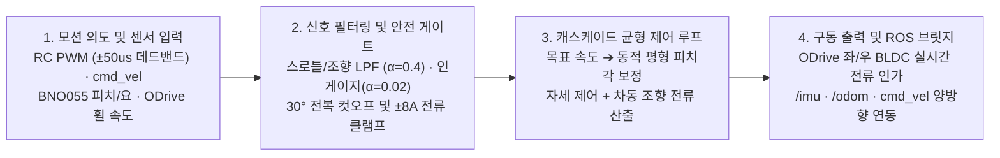

<div align="center">

# Self-Balancing Robot with Arduino and ROS (한국어)

**실물 2륜 밸런싱 로봇의 온보드 실시간 전류 제어(Arduino + ODrive + BNO055)와 ROS/Gazebo SLAM·자율주행 명령 계층 분리를 통합한 엔드투엔드 로봇 스택입니다.**

[](#quick-start)
[-FF6F00)](#capabilities)
[](#quick-start)
[](LICENSE)

[**Quick Start**](#quick-start) · [**How It Works**](#how-it-works) · [**Capabilities**](#capabilities) · [**Showcases**](#showcases) · [**Hardware & Firmware**](#hardware--firmware) · [**FAQ**](#faq)

```bash
roslaunch balance_robot_workflows robot_navigation_lidar.launch
```


</div>

---

## Quick Start

### 1) 환경 구성 및 빌드 (Setup)

```bash
git clone https://github.com/yg-gulbi/Self-Balancing-Robot-with-Arduino-and-ROS.git
cd Self-Balancing-Robot-with-Arduino-and-ROS/ros_ws
catkin_make
source devel/setup.bash
```

### 2) 핵심 실행 (Run)

```bash
# Gazebo 자율주행 및 SLAM 통합 시뮬레이션 실행
roslaunch balance_robot_workflows robot_navigation_lidar.launch

# 원격 LiDAR 브링업 실행
roslaunch robot_bringup robot_remote_lidar.launch
```

### 3) 실물 하드웨어 단계별 검증 및 플래싱 (Control)

```text
1. firmware/testers/receiver_pwm_test.ino       # RC 수신기 신호 검증
2. firmware/testers/hall_sensor_test.ino        # 홀 센서 엔코더 검증
3. firmware/testers/odrive_receiver_test.ino    # ODrive 통신 검증
4. firmware/testers/motor_current_test.ino      # 모터 ±8A 전류 제한 검증
5. firmware/physical_balance_controller/physical_balance_controller.ino # 본체 제어기 업로드
```

---

## How It Works



---

## Capabilities

| 대상 / 기능 (Target / Feature) | 반환 결과 및 동작 (What It Returns) | 요구사항 및 트리거 (Requirements & Guide) |
| :--- | :--- | :--- |
| **실물 자립 밸런싱 & 주행** | BNO055 피치/각속도 + ODrive 홀 엔코더 속도 피드백 기반 실시간 전류 제어 | [physical_balance_controller.ino](firmware/physical_balance_controller/physical_balance_controller.ino) |
| **다중 안전 보호 계층** | `30°` 전복 컷오프, `±8 A` 전류 클램프, `±50 us` 데드밴드 및 지수이동평균(EMA) 필터 | [control_algorithm.md](firmware/physical_balance_controller/control_algorithm.md) |
| **ROS/Gazebo SLAM & Nav** | `move_base` 상위 속도 의도를 균형 제어 계층(`/before_vel` ➔ `/cmd_vel`)과 결합해 주행 | [balance_robot_workflows](ros_ws/src/balance_robot_workflows) |
| **Arduino ↔ ROS 브릿지** | `/imu`, `/odom`, `cmd_vel` 토픽 발행 및 수신 실험 | [physical_balance_controller_ros.ino](firmware/physical_balance_controller_ros/physical_balance_controller_ros.ino) |

---

## Showcases

| 검증 항목 | 측정 결과 및 엔지니어링 스펙 |
| :--- | :--- |
| **연속 직립 유지 시간** | **약 1시간** 제자리 직립 유지 |
| **실내 주행 검증** | **10 m 복도 주행** 및 장애물 코스 주행 성공 |
| **안전 컷오프 각도** | **`30.0°`** (보호 브래킷 `28.0°` 접지 기준) |
| **ODrive 전류 클램프** | **`±8.0 A`** 하드웨어/펌웨어 제한 |
| **RC 노이즈 억제** | 데드밴드 **`±50 us`**, 스로틀/조향 필터 `α = 0.4`, 인게이지 필터 `α = 0.02` |

---

## Hardware & Firmware

상세 문서는 [메인 README.md](README.md) 및 [docs/](docs) 디렉토리를 참조하세요.

---

## FAQ

<details>
<summary><b>전체 트러블슈팅 이력과 한계점은 어디서 볼 수 있나요?</b></summary>

[docs/troubleshooting.md](docs/troubleshooting.md) 및 [docs/results-and-limitations.md](docs/results-and-limitations.md)에 센서 노이즈, ODrive 전류 폭주 방지, Sim-to-Real 한계가 상세히 기록되어 있습니다.
</details>
