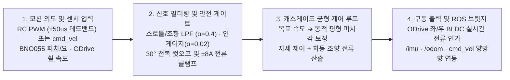
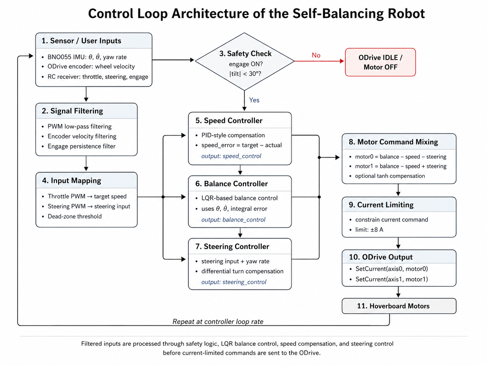
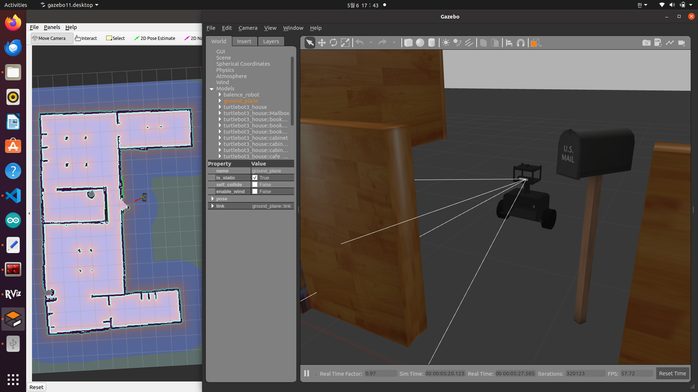
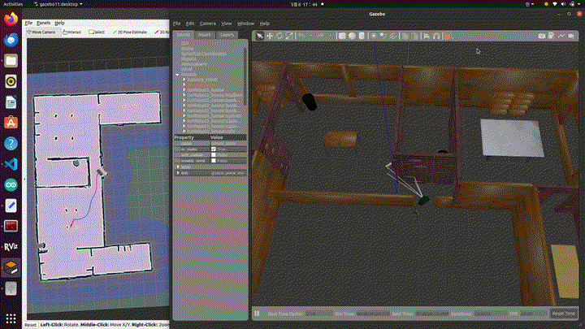
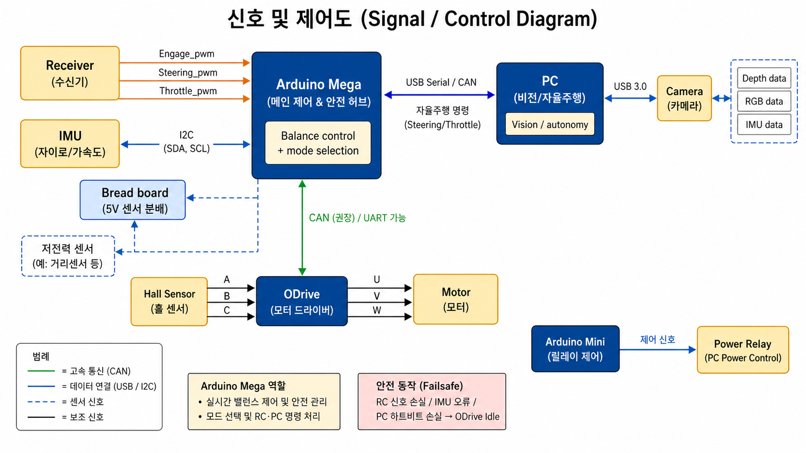
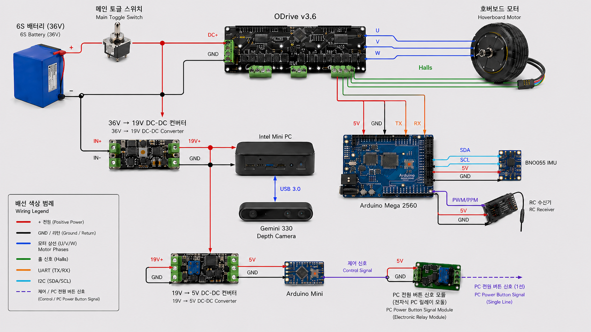

<div align="center">

# Self-Balancing Robot with Arduino and ROS

**End-to-end two-wheeled self-balancing robot stack combining Arduino real-time ODrive current control, BNO055/encoder fusion, and ROS/Gazebo SLAM & navigation workflows.**

실물 2륜 자립 밸런싱 로봇의 온보드 실시간 전류 제어(Arduino Mega 2560 + BNO055 IMU + ODrive BLDC)와 ROS/Gazebo 기반 시뮬레이션·SLAM·자율주행 명령 계층 분리(Sim-to-Real Command Layering)를 통합 구축한 프로젝트입니다.

[](#quick-start)
[-FF6F00)](#capabilities)
[](#how-it-works)
[](#quick-start)
[](LICENSE)

[**Quick Start**](#quick-start) · [**How It Works**](#how-it-works) · [**Capabilities**](#capabilities) · [**Showcases**](#showcases) · [**Hardware & Firmware**](#hardware--firmware) · [**FAQ**](#faq)

```bash
roslaunch balance_robot_workflows robot_navigation_lidar.launch
```


</div>

---

## Quick Start

### 1) 환경 구성 및 빌드 (Setup)

실물 로봇 제어를 위한 Arduino 펌웨어(`firmware/`)와 시뮬레이션/네비게이션을 위한 ROS 워크스페이스(`ros_ws/`)가 분리 구성되어 있습니다.

```bash
# 1. 저장소 클론 및 ROS 워크스페이스 이동
git clone https://github.com/yg-gulbi/Self-Balancing-Robot-with-Arduino-and-ROS.git
cd Self-Balancing-Robot-with-Arduino-and-ROS/ros_ws

# 2. Catkin 워크스페이스 빌드 및 환경 로드
catkin_make
source devel/setup.bash
```

### 2) 핵심 실행 — ROS/Gazebo 자율주행 및 브링업 (Run)

Gazebo 시뮬레이션 상에서 뎁스/LiDAR 기반 자율주행 워크플로우 또는 원격 LiDAR 브링업 노드를 실행합니다.

```bash
# Gazebo + RViz 자율주행(Navigation & SLAM) 통합 워크플로우 실행
roslaunch balance_robot_workflows robot_navigation_lidar.launch

# 원격 LiDAR 센서 및 로봇 브링업 실행
roslaunch robot_bringup robot_remote_lidar.launch
```

### 3) 실물 로봇 펌웨어 플래싱 및 단위 검증 (Control)

실물 로봇에 메인 밸런싱 컨트롤러를 업로드하기 전, `firmware/testers/` 하위의 4단계 하드웨어 격리 테스터로 센서와 구동계를 개별 검증합니다.

```text
# 1단계: 단위 하드웨어 격리 검증 (Arduino IDE 업로드)
firmware/testers/receiver_pwm_test.ino       # RC 수신기 PWM 데드밴드 및 지터 검증
firmware/testers/hall_sensor_test.ino        # 휠 홀 센서 엔코더 피드백 검증
firmware/testers/odrive_receiver_test.ino    # ODrive 시리얼 통신 및 응답 검증
firmware/testers/motor_current_test.ino      # 모터 전류 제한(±8A) 및 방향 검증

# 2단계: 실물 로봇 메인 밸런싱 펌웨어 업로드
firmware/physical_balance_controller/physical_balance_controller.ino
```

---

## How It Works

상위 모션 의도(RC 조종기 또는 ROS `move_base` 속도 명령)를 모터에 직접 인가하지 않고, 온보드 안전 게이트와 피치/속도 캐스케이드 제어 루프를 거쳐 ODrive 전류 지령(`±8 A`)으로 변환하는 4단계 제어 아키텍처입니다.



<p align="center">
  
</p>

---

## Capabilities

| 대상 / 기능 (Target / Feature) | 반환 결과 및 동작 (What It Returns) | 요구사항 및 트리거 (Requirements & Guide) |
| :--- | :--- | :--- |
| **실물 자립 밸런싱 & RC 주행** | 휠 엔코더 속도 피드백과 BNO055 피치/각속도를 결합하여 직립 유지 및 전후진·차동 조향 주행 수행 | [physical_balance_controller.ino](firmware/physical_balance_controller/physical_balance_controller.ino), [제어 알고리즘 명세](firmware/physical_balance_controller/control_algorithm.md) |
| **다중 안전 보호 계층 (Safety Gate)** | 보호 브래킷 접지각(`28°`) 기준 **`30°` 모터 자동 차단(Cutoff)**, **`±8 A` 전류 클램프**, RC 노이즈 데드밴드(`±50 us`) 및 저역통과 필터 적용 | [troubleshooting.md](docs/troubleshooting.md) 및 펌웨어 안전 루프 상시 동작 |
| **ROS/Gazebo 자율주행 & SLAM** | `move_base` ➔ `/before_vel` ➔ `balance_robot_control` ➔ `/cmd_vel` 명령 계층 분리 구조로 주행하면서 직립 유지 및 지도 생성 | `roslaunch balance_robot_workflows robot_navigation_lidar.launch` 실행 |
| **Arduino ↔ ROS 양방향 브릿지** | 실물 컨트롤러에서 `/imu`, `/odom` 토픽을 발행하고, RC 수신기 신호를 ROS `cmd_vel` 토픽으로 변환 전송 | [physical_balance_controller_ros.ino](firmware/physical_balance_controller_ros/physical_balance_controller_ros.ino), [rc_to_ros_cmd_vel_bridge.ino](firmware/testers/rc_to_ros_cmd_vel_bridge.ino) |
| **기구 설계 및 3D 프린팅 프레임** | 보드 플레이트, 센서 헤드, 배터리/제어기 마운트 등 출력용 STL 및 원본 CAD 제공 | [mechanical/](mechanical) 및 [docs/hardware.md](docs/hardware.md) 참조 |

---

## Showcases

### 1. 실물 하드웨어 불안정성 격리 해결 및 정량 검증 결과
- **문제 해결 (IMU 적분 드리프트 제거)**: 초기 IMU 가속도 적분 기반 속도 추정이 차체 기울기(Tilt) 성분에 오염되어 발산하는 현상을 규명하고, ODrive 홀 엔코더 기반 휠 속도 피드백으로 전면 교체하여 **약 1시간 연속 제자리 직립 및 10 m 복도·장애물 주행**을 달성했습니다.

| 검증 영역 (Verification Area) | 정량적 엔지니어링 지표 및 설정값 (Measured Result & Spec) | 상세 문서 및 미디어 |
| :--- | :--- | :--- |
| **실물 연속 직립 유지 시간** | **약 1시간 (1 Hour)** 연속 제자리 밸런싱 유지 | [복도 주행 GIF](media/hero/physical_balance_hallway.gif) |
| **실물 주행 테스트** | **10 m 실내 복도 직진** 및 장애물 회피 코스 주행 완료 | [장애물 주행 GIF](media/demos/physical_balance_obstacle_course.gif) |
| **전복 방지 각도 컷오프 (Tilt Cutoff)** | **`30.0°`** 즉시 모터 전류 차단 (보호 브래킷 `28.0°` 바닥 접촉 기준) | [results-and-limitations.md](docs/results-and-limitations.md) |
| **모터 전류 제한 (Current Clamp)** | **`±8.0 A`** 펌웨어 하드 클램프 적용 (과전류 폭주 원천 차단) | [motor_current_test.ino](firmware/testers/motor_current_test.ino) |
| **RC PWM 노이즈 필터링** | 데드밴드 **`±50 us`**, 스로틀/조향 LPF `α = 0.4`, 인게이지 LPF `α = 0.02` | [control_algorithm.md](firmware/physical_balance_controller/control_algorithm.md) |
| **Arduino-ROS 토픽 연동** | `/imu`, `/odom`, `cmd_vel` 실시간 발행 및 `rostopic echo` 검증 완료 | [sim2real.md](docs/sim2real.md) |

### 2. Sim-to-Real 명령 계층 분리 (Command Layering) 및 하드웨어 배선
<p align="center">
  
</p>
<p align="center">
  
</p>

<table>
  <tr>
    <td width="50%">
      
    </td>
    <td width="50%">
      
    </td>
  </tr>
  <tr>
    <td valign="top">
      <strong>제어 권한 분리 (Control Authority)</strong><br>
      실시간 균형 루프는 온보드 Arduino가 독점하며, 상위 ROS/RC 명령은 목표 평형점을 이동시키는 모션 의도(Motion Intent)로만 주입됩니다.
    </td>
    <td valign="top">
      <strong>전장 배선 아키텍처 (Hardware Wiring)</strong><br>
      36V 전원부, ODrive 3.6, Arduino Mega 2560, BNO055 IMU, FrSky 수신기, 온보드 PC, Gemini 330 뎁스 카메라 통합 배선도입니다.
    </td>
  </tr>
</table>

---

## Hardware & Firmware

### 저장소 디렉토리 및 펌웨어 매핑 레퍼런스

| 경로 / 스케치 | 역할 구분 | 발행/구독 데이터 및 설명 |
| :--- | :--- | :--- |
| [firmware/physical_balance_controller/](firmware/physical_balance_controller/physical_balance_controller.ino) | 실물 메인 제어기 | BNO055 + ODrive + RC 기반 실물 로봇 직립·주행 메인 펌웨어 |
| [firmware/physical_balance_controller_ros/](firmware/physical_balance_controller_ros/physical_balance_controller_ros.ino) | ROS 연동 제어기 | 실물 직립 제어와 동시에 ROS로 `/imu`, `/odom` 토픽 발행 |
| [firmware/testers/rc_to_ros_cmd_vel_bridge.ino](firmware/testers/rc_to_ros_cmd_vel_bridge.ino) | RC ➔ ROS 브릿지 | FrSky RC 수신기 입력을 ROS `cmd_vel` 속도 명령으로 변환 발행 |
| [ros_ws/src/balance_robot_control/](ros_ws/src/balance_robot_control) | 시뮬레이션 제어 | Gazebo 상에서 상위 속도 명령(`/before_vel`)을 균형 제어 `/cmd_vel`로 변환 |
| [ros_ws/src/balance_robot_workflows/](ros_ws/src/balance_robot_workflows) | SLAM & Nav | LiDAR/Depth 기반 SLAM 지도 생성 및 `move_base` 자율주행 런치 패키지 |
| [mechanical/](mechanical) | 기구/CAD 자산 | 3D 프린팅 프레임 STL, STEP/CAD 원본 및 센서 헤드 구조물 |
| [docs/](docs) | 엔지니어링 문서 | [하드웨어](docs/hardware.md) · [개발과정](docs/development-process.md) · [Sim2Real](docs/sim2real.md) · [트러블슈팅](docs/troubleshooting.md) |

---

## FAQ

<details>
<summary><b>속도 추정에 IMU 가속도 적분 대신 휠 엔코더를 사용한 이유는 무엇인가요?</b></summary>

2륜 밸런싱 로봇은 주행 및 균형 유지 과정에서 차체가 앞뒤로 지속해서 기울어집니다(Pitch). 이때 IMU 선형 가속도에는 중력 가속도의 기울기 성분($g \sin\theta$)이 섞이게 되어, 이를 적분하면 실제 이동 속도와 무관하게 속도가 발산(Drift)합니다. 따라서 자세(각도·각속도)는 BNO055 IMU로 측정하고, 선속도는 ODrive 홀 센서 엔코더에서 직접 읽어오도록 분리하여 드리프트를 원천 해결했습니다.
</details>

<details>
<summary><b>시뮬레이션의 자율주행(move_base) 명령은 밸런싱 제어기와 어떻게 결합되나요?</b></summary>

일반 차동 구동 로봇처럼 `move_base`가 바퀴 속도를 직접 제어하면 로봇이 즉시 전복됩니다. 본 프로젝트에서는 `move_base`의 출력을 `/before_vel`(상위 모션 의도)로 분리하여 수신한 뒤, `balance_robot_control` 노드가 현재 피치각과 결합해 직립을 해치지 않는 안전한 `/cmd_vel`로 변환하는 **명령 계층 분리(Command Layering)** 구조를 적용했습니다.
</details>

<details>
<summary><b>서드파티 ROS 패키지 의존성은 어떻게 구성하나요?</b></summary>

저장소 경량화를 위해 외부 오픈소스 패키지(`rtabmap_ros`, `OrbbecSDK_ROS1`, `depthimage_to_laserscan`, `rosserial`)는 기본 트리에 벤더링하지 않았습니다. 전체 시뮬레이션 워크플로우 재현 시에는 `ros_ws/src/third_party/` 하위에 해당 패키지를 클론하여 `catkin_make`를 수행하면 됩니다.
</details>
